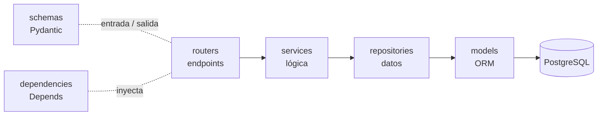
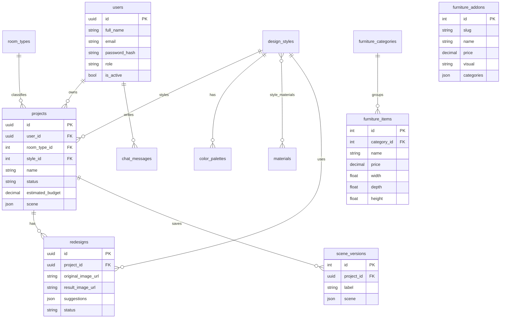

<div align="center">

# Habita · Backend

**API REST de Habita: diseño de interiores con inteligencia artificial y modelado 3D.**

Proyecto final de **Patrones de Diseño**


</div>

## ¿En qué consiste?

**Habita** permite tomar o subir una foto de un espacio, elegir un estilo y ver cómo quedaría rediseñado por la IA, armar el espacio en un editor 3D con muebles del catálogo, calcular un presupuesto y guardar proyectos. **Lumi**, la asistente, guía al usuario por voz o texto.

Este repositorio es el **backend**: API REST con FastAPI, base de datos PostgreSQL y conexión con la IA (Google Gemini, intercambiable desde el `.env`).

| Componente | Repositorio | Producción |
|---|---|---|
| Frontend | [decora-ia-frontend](https://github.com/Santiago425/decora-ia-frontend) | https://decora-ia-frontend.vercel.app |
| Backend | [decora-ia-backend](https://github.com/Santiago425/decora-ia-backend) | https://decora-ia-backend.onrender.com/api/v1/hello |
| Documentación de la API | Swagger UI | https://decora-ia-backend.onrender.com/api/v1/docs |

## Arquitectura por capas



Los routers nunca tocan la base de datos: reciben los servicios por **inyección de dependencias** (`Depends` de FastAPI) y los servicios trabajan solo con repositorios.

## Patrones aplicados

| Patrón | Tipo | Dónde | Problema que resuelve |
|---|---|---|---|
| **Singleton** | Creacional | [`app/core/settings.py`](app/core/settings.py) | La configuración del `.env` se lee una sola vez y se comparte en toda la app. |
| **Singleton** | Creacional | [`app/patterns/singleton.py`](app/patterns/singleton.py), [`app/core/database.py`](app/core/database.py) | Una sola conexión (motor y pool) a la base de datos por proceso. |
| **Repository** | Arquitectura | [`app/repositories/`](app/repositories) | Los servicios piden y guardan entidades sin escribir SQL. |
| **Inyección de dependencias** | Arquitectura | [`app/dependencies.py`](app/dependencies.py) | Cada endpoint recibe sus servicios ya armados; en las pruebas se pueden reemplazar. |
| **Singleton** | Creacional | [`app/patterns/ai/ai_client.py`](app/patterns/ai/ai_client.py) | Un solo cliente de IA por proceso, con su caché compartida. |
| **Builder** | Creacional | [`app/patterns/builders/redesign_request_builder.py`](app/patterns/builders/redesign_request_builder.py) | Arma paso a paso la petición a la IA (foto, habitación, estilo, paleta, presupuesto, conservar estructura) y la valida al final. |
| **Adapter** | Estructural | [`app/patterns/ai/`](app/patterns/ai) | `GeminiImageEditor`, `HuggingFaceImageEditor` y `MockImageEditor` traducen cada API a la misma interfaz; el proveedor se cambia con `AI_IMAGE_PROVIDER` / `AI_TEXT_PROVIDER`. |
| **Adapter** | Estructural | [`app/patterns/storage/storage_adapter.py`](app/patterns/storage/storage_adapter.py) | Guardar fotos en disco (desarrollo) o en la base de datos en la nube (producción) con la misma interfaz (`STORAGE_PROVIDER`). |
| **Decorator** | Estructural | [`app/patterns/ai/ai_decorators.py`](app/patterns/ai/ai_decorators.py) | Añade caché y registro de tiempos a cualquier proveedor de IA sin modificarlo. |
| **Facade** | Estructural | [`app/patterns/facades/redesign_facade.py`](app/patterns/facades/redesign_facade.py) | `create_redesign()` valida la foto, la guarda, llama a la IA, calcula sugerencias y presupuesto y registra el proyecto en una sola llamada. |
| **Chain of Responsibility** | Comportamiento | [`app/patterns/validators/image_validators.py`](app/patterns/validators/image_validators.py) | Formato → tamaño → resolución → contenido: cada validador pasa la foto al siguiente o la rechaza con un mensaje claro. |
| **Strategy** | Comportamiento | [`app/patterns/strategies/budget_strategies.py`](app/patterns/strategies/budget_strategies.py) | Presupuesto económico, medio o premium: cada estrategia elige productos distintos sin pasarse del presupuesto. |
| **State** | Comportamiento | [`app/patterns/states/redesign_states.py`](app/patterns/states/redesign_states.py) | Subiendo → procesando → listo / error: cada estado decide a cuál se puede pasar (un error se puede reintentar). |
| **State** | Comportamiento | [`app/patterns/states/project_states.py`](app/patterns/states/project_states.py) | Borrador → en diseño → terminado: editar un borrador lo pasa a diseño y un proyecto terminado no se puede editar hasta reabrirlo. |
| **Builder** + director | Creacional | [`app/patterns/builders/room_builder.py`](app/patterns/builders/room_builder.py) | `RoomBuilder` arma la escena 3D (medidas, paredes, piso, luz, muebles) y `StarterLayoutDirector` coloca los muebles sugeridos según el tipo de habitación. |
| **Memento** | Comportamiento | [`app/patterns/mementos/scene_memento.py`](app/patterns/mementos/scene_memento.py) | Guarda versiones de la escena y vuelve a una de ellas sin exponer cómo se almacenan; el repositorio de versiones hace de cuidador y conserva las últimas `SCENE_VERSIONS_LIMIT`. |
| **Prototype** | Creacional | [`app/patterns/prototypes/project_prototype.py`](app/patterns/prototypes/project_prototype.py) | Duplicar un proyecto copia su escena completa con identificadores nuevos. |
| **Visitor** | Comportamiento | [`app/patterns/visitors/scene_visitors.py`](app/patterns/visitors/scene_visitors.py) | Recorre habitación, grupos y muebles para calcular el presupuesto con los precios de la base de datos (el cliente no puede alterarlo). |

Los demás patrones (Factory Method, Abstract Factory, Prototype, Composite, Command, Memento y Template Method) se suman en las siguientes fases.

## Base de datos

Todas las opciones de la app (estilos, tipos de habitación, categorías y catálogo de muebles, complementos, materiales y paletas) viven en la base de datos: para agregar un estilo nuevo basta con insertarlo y aparece en la app sin tocar código.



Las tablas se crean con migraciones de **Alembic** ([`migrations/`](migrations)) que se ejecutan solas al arrancar el contenedor.

## Endpoints

| Método | Ruta | Descripción |
|---|---|---|
| `GET` | `/api/v1/hello` | Hello World |
| `GET` | `/api/v1/health` | Estado de la API y de la base de datos |
| `POST` | `/api/v1/auth/register` | Crea una cuenta de usuario |
| `POST` | `/api/v1/auth/login` | Inicia sesión como usuario o administrador (`role`) |
| `GET` | `/api/v1/auth/me` | Datos de la sesión 🔐 |
| `GET` | `/api/v1/dashboard` | Resumen del usuario: proyectos, rediseños, estilo favorito, presupuesto, actividad y últimos proyectos 🔐 |
| `POST` | `/api/v1/redesigns` | Rediseña una foto (multipart: `image`, `room_type`, `style`, `palette`, `budget`, `keep_structure`) 🔐 |
| `GET` | `/api/v1/redesigns/{id}` | Consulta un rediseño 🔐 |
| `POST` | `/api/v1/redesigns/{id}/variations` | Genera otra versión con la misma foto 🔐 |
| `POST` | `/api/v1/redesigns/{id}/retry` | Reintenta un rediseño que falló 🔐 |
| `GET` | `/api/v1/files/{id}` | Imagen guardada en la base de datos |
| `GET` | `/api/v1/catalog/styles` | Estilos con sus paletas y materiales |
| `GET` | `/api/v1/catalog/room-types` | Tipos de habitación |
| `GET` | `/api/v1/catalog/furniture-categories` | Categorías de muebles |
| `GET` | `/api/v1/catalog/furniture?category=` | Catálogo de muebles |
| `GET` | `/api/v1/catalog/materials?surface=` | Materiales de pared, piso y muebles |
| `GET` | `/api/v1/catalog/palettes` | Paletas de colores |
| `GET` | `/api/v1/catalog/addons` | Complementos de muebles (cojines, patas de latón, luz LED…) |
| `GET` | `/api/v1/projects` | Proyectos del usuario 🔐 |
| `POST` | `/api/v1/projects` | Crea un proyecto con su habitación 3D (`name`, `room_type`, `style`, `furnished`) 🔐 |
| `GET` | `/api/v1/projects/{id}` | Proyecto con su escena 3D 🔐 |
| `PATCH` | `/api/v1/projects/{id}` | Cambia nombre, estilo o tipo de habitación 🔐 |
| `DELETE` | `/api/v1/projects/{id}` | Elimina un proyecto 🔐 |
| `PUT` | `/api/v1/projects/{id}/scene` | Guarda la escena y recalcula el presupuesto 🔐 |
| `POST` | `/api/v1/projects/{id}/status` | Cambia el estado (`start`, `finish`, `reopen`) 🔐 |
| `POST` | `/api/v1/projects/{id}/duplicate` | Duplica el proyecto 🔐 |
| `GET` / `POST` | `/api/v1/projects/{id}/versions` | Lista o guarda versiones de la escena 🔐 |
| `GET` | `/api/v1/projects/{id}/versions/{version_id}` | Escena de una versión 🔐 |
| `POST` | `/api/v1/projects/{id}/versions/{version_id}/restore` | Vuelve a una versión 🔐 |

🔐 = requiere `Authorization: Bearer <token>`.

## Cuentas de prueba

| Rol | Correo | Contraseña |
|---|---|---|
| Usuario | `usuario@habita.app` | `Habita2026` |
| Administrador | `admin@habita.app` | `Habita2026` |

Las crea [`app/seed.py`](app/seed.py) junto con el catálogo ([`app/seed_data/catalog.json`](app/seed_data/catalog.json)). Correos, nombres y contraseña salen del `.env` (`DEMO_*`).

## Seguridad

- Contraseñas con **bcrypt**; nunca se guardan ni se devuelven en texto plano.
- Sesiones con **JWT** firmado y con expiración (`JWT_EXPIRE_MINUTES`).
- Un usuario normal no puede entrar por el acceso de administrador, y el registro solo crea usuarios normales.
- Mismo mensaje y mismo tiempo de respuesta para correo inexistente o contraseña incorrecta.
- Límite de intentos por IP en login y registro (`LOGIN_RATE_LIMIT`, `REGISTER_RATE_LIMIT`).
- CORS restringido a `CORS_ORIGINS` y cabeceras de seguridad en cada respuesta.
- Contenedor sin usuario root y secretos solo en variables de entorno.

## Ejecutar en local

```bash
python -m venv .venv && source .venv/bin/activate
pip install -r requirements-dev.txt
cp .env.example .env
alembic upgrade head
python -m app.seed
uvicorn app.main:app --reload      # http://localhost:8000/api/v1/docs
pytest
```

Con Docker:

```bash
docker build -t habita-backend .
docker run -p 8000:8000 --env-file .env habita-backend
```

## Variables de entorno

Todas están en [`.env.example`](.env.example) con comentarios y se leen en un solo lugar: [`app/core/settings.py`](app/core/settings.py).

| Variable | Para qué |
|---|---|
| `APP_NAME`, `APP_ENV`, `API_PREFIX`, `PORT` | Datos generales de la aplicación |
| `DATABASE_URL`, `DATABASE_ECHO` | Conexión a la base de datos (SQLite en local, PostgreSQL en producción) |
| `CORS_ORIGINS` | Orígenes del frontend permitidos |
| `JWT_SECRET`, `JWT_ALGORITHM`, `JWT_EXPIRE_MINUTES` | Firma y duración de las sesiones |
| `LOGIN_RATE_LIMIT`, `REGISTER_RATE_LIMIT` | Límite de intentos |
| `SEED_ON_STARTUP` | Cargar catálogo y cuentas de prueba al arrancar |
| `SEED_DEMO_PROJECTS` | Agregar proyectos de ejemplo a la cuenta de usuario de prueba |
| `DEMO_PASSWORD`, `DEMO_USER_*`, `DEMO_ADMIN_*` | Cuentas de prueba |
| `CURRENCY_CODE`, `BUDGET_ECONOMIC_MAX`, `BUDGET_STANDARD_MAX` | Moneda y límites de cada estrategia de presupuesto |
| `STORAGE_PROVIDER`, `MEDIA_DIR`, `MEDIA_URL_PATH` | Dónde se guardan las fotos |
| `MAX_UPLOAD_MB`, `MIN_IMAGE_SIDE`, `MAX_IMAGE_SIDE` | Reglas de la cadena de validación de imágenes |
| `AI_TEXT_PROVIDER`, `AI_IMAGE_PROVIDER`, `AI_TIMEOUT_SECONDS`, `AI_CACHE_SIZE`, `REDESIGN_RATE_LIMIT` | Proveedor de IA, tiempo de espera, caché y límite de rediseños |
| `GEMINI_API_KEY`, `GEMINI_API_BASE_URL`, `GEMINI_TEXT_MODEL`, `GEMINI_IMAGE_MODEL` | Google Gemini |
| `HUGGINGFACE_API_TOKEN`, `HUGGINGFACE_API_BASE_URL`, `HUGGINGFACE_IMAGE_MODEL` | Hugging Face (alternativa para imágenes) |
| `ROOM_DEFAULT_WIDTH`, `ROOM_DEFAULT_LENGTH`, `ROOM_DEFAULT_HEIGHT` | Medidas de la habitación de un proyecto 3D nuevo |
| `SCENE_MAX_NODES`, `SCENE_VERSIONS_LIMIT` | Límite de muebles por escena y de versiones guardadas |

## Estructura

```
app/
├── core/            settings (Singleton), database, security, rate limit
├── models/          Modelos ORM (SQLAlchemy)
├── schemas/         Entrada y salida (Pydantic)
├── repositories/    Acceso a datos (Repository)
├── services/        Lógica de negocio
├── patterns/        Patrones: ai, builders, facades, states, storage, strategies, validators
├── routers/         Endpoints REST
├── seed_data/       Catálogo inicial en JSON
├── dependencies.py  Inyección de dependencias
├── seed.py          Script de semilla
└── main.py
migrations/          Migraciones de Alembic
tests/               Pruebas con pytest
```

## Equipo

| Integrante | GitHub |
|---|---|
| Santiago Campoverde | [@Santiago425](https://github.com/Santiago425) |
| Never Melo | [@neber18](https://github.com/neber18) |
