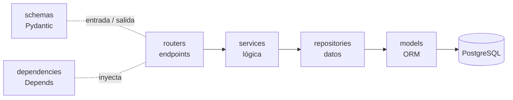
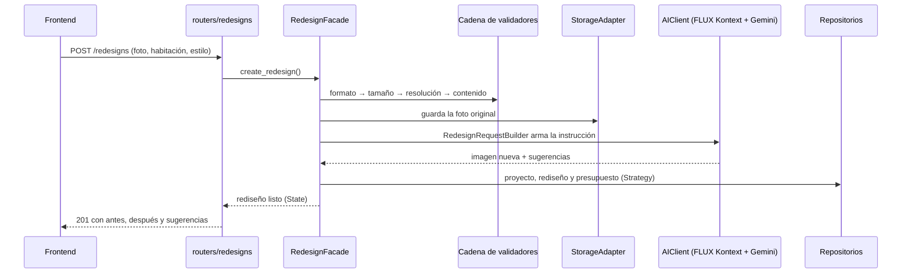
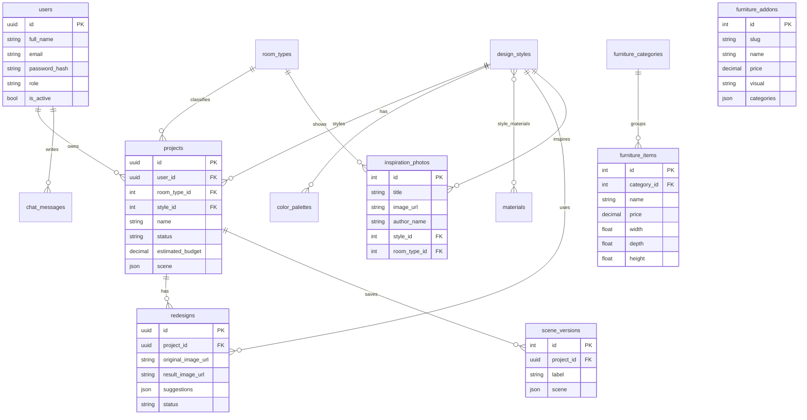

<div align="center">

# Habita · Backend

**API REST de Habita: diseño de interiores con inteligencia artificial y modelado 3D.**

Proyecto final de **Patrones de Diseño**

[**Abrir la app**](https://decora-ia-frontend.vercel.app) · [API (Swagger)](https://decora-ia-backend.onrender.com/api/v1/docs) · [Frontend](https://github.com/Santiago425/decora-ia-frontend)


</div>


## Contenido

- [¿En qué consiste?](#en-qué-consiste)
- [Así se ve](#así-se-ve)
- [Arquitectura por capas](#arquitectura-por-capas)
- [Inteligencia artificial](#inteligencia-artificial)
- [Patrones aplicados](#patrones-aplicados)
- [Base de datos](#base-de-datos)
- [Endpoints](#endpoints)
- [Cuentas de prueba](#cuentas-de-prueba)
- [Seguridad](#seguridad)
- [Calidad](#calidad)
- [Ejecutar en local](#ejecutar-en-local)
- [Variables de entorno](#variables-de-entorno)
- [Estructura](#estructura)
- [Equipo](#equipo)

## ¿En qué consiste?

**Habita** permite tomar o subir una foto de un espacio, elegir un estilo y ver cómo quedaría rediseñado por la IA, armar el espacio en un editor 3D con muebles del catálogo, calcular un presupuesto y guardar proyectos. **Lumi**, la asistente, guía al usuario por voz o texto.

Este repositorio es el **backend**: API REST con FastAPI, base de datos PostgreSQL en Neon y conexión con la IA: **FLUX.1 Kontext** (Hugging Face) para la imagen y **Google Gemini** para el texto, los dos intercambiables desde el `.env`.

| Componente | Repositorio | Producción |
|---|---|---|
| Frontend | [decora-ia-frontend](https://github.com/Santiago425/decora-ia-frontend) | https://decora-ia-frontend.vercel.app |
| Backend | [decora-ia-backend](https://github.com/Santiago425/decora-ia-backend) | https://decora-ia-backend.onrender.com/api/v1/hello |
| Documentación de la API | Swagger UI | https://decora-ia-backend.onrender.com/api/v1/docs |

## Así se ve

Capturas de la app desplegada, que consume esta API. Hay más en el [README del frontend](https://github.com/Santiago425/decora-ia-frontend#capturas).

| Rediseño con IA (`POST /redesigns`)                                                                                   | Editor 3D (`/projects/{id}/scene`)                                                                                   |
| --------------------------------------------------------------------------------------------------------------------- | -------------------------------------------------------------------------------------------------------------------- |
|  |        |
| **Lista de compras (Composite + Visitor)**                                                                            | **Panel de administración (Proxy, Template Method, Bridge)**                                                         |
|  |  |

## Arquitectura por capas



Los routers nunca tocan la base de datos: reciben los servicios por **inyección de dependencias** (`Depends` de FastAPI) y los servicios trabajan solo con repositorios. Los patrones viven en [`app/patterns/`](app/patterns), separados por familia.

Así viaja un rediseño por las capas:



## Inteligencia artificial

| Tarea                                | Proveedor en producción                               | Patrones                             |
| ------------------------------------ | ----------------------------------------------------- | ------------------------------------ |
| Foto rediseñada y ediciones puntuales | **FLUX.1 Kontext** en Hugging Face Inference Providers | Abstract Factory, Adapter, Decorator |
| Sugerencias, colores y materiales    | **Google Gemini**                                     | Adapter                              |
| Estilo desde una foto de inspiración | Gemini describe la foto y FLUX la aplica              | Adapter                              |
| Lumi                                 | Gemini, con reglas en español de respaldo             | Strategy, Chain of Responsibility    |

- El proveedor se cambia con `AI_IMAGE_PROVIDER` y `AI_TEXT_PROVIDER` (`huggingface`, `gemini`, `cloudflare` o `mock`) sin tocar código.
- **Errores honestos:** con `AI_IMAGE_FALLBACK=none` (valor por defecto), si el proveedor falla o devuelve la misma foto (`UnchangedImageGuard`), el rediseño queda en estado de error con el mensaje real y se puede reintentar. `AI_IMAGE_FALLBACK=mock` solo sirve para demos sin conexión.
- Sin claves, todo funciona con el proveedor `mock`, que es el que usan las pruebas.

## Patrones aplicados

| Patrón | Tipo | Dónde | Problema que resuelve |
|---|---|---|---|
| **Singleton** | Creacional | [`app/core/settings.py`](app/core/settings.py) | La configuración del `.env` se lee una sola vez y se comparte en toda la app. |
| **Singleton** | Creacional | [`app/patterns/singleton.py`](app/patterns/singleton.py), [`app/core/database.py`](app/core/database.py) | Una sola conexión (motor y pool) a la base de datos por proceso. |
| **Repository** | Arquitectura | [`app/repositories/`](app/repositories) | Los servicios piden y guardan entidades sin escribir SQL. |
| **Inyección de dependencias** | Arquitectura | [`app/dependencies.py`](app/dependencies.py) | Cada endpoint recibe sus servicios ya armados; en las pruebas se pueden reemplazar. |
| **Singleton** | Creacional | [`app/patterns/ai/ai_client.py`](app/patterns/ai/ai_client.py) | Un solo cliente de IA por proceso, con su caché compartida. |
| **Abstract Factory** | Creacional | [`app/patterns/ai/provider_factories.py`](app/patterns/ai/provider_factories.py) | Cada proveedor (`GeminiFactory`, `CloudflareFactory`, `HuggingFaceFactory`, `MockFactory`) crea su familia de productos de IA: editor de imágenes y asesor de diseño. Agregar un proveedor es agregar una fábrica. |
| **Builder** | Creacional | [`app/patterns/builders/redesign_request_builder.py`](app/patterns/builders/redesign_request_builder.py) | Arma paso a paso la petición a la IA (foto, habitación, estilo, paleta, presupuesto, conservar estructura) y la valida al final. |
| **Adapter** | Estructural | [`app/patterns/ai/`](app/patterns/ai) | `GeminiImageEditor`, `CloudflareImageEditor`, `HuggingFaceImageEditor` y `MockImageEditor` traducen cada API a la misma interfaz; el proveedor se cambia con `AI_IMAGE_PROVIDER` / `AI_TEXT_PROVIDER`. |
| **Adapter** | Estructural | [`app/patterns/ai/gemini_adapter.py`](app/patterns/ai/gemini_adapter.py) | Estilo desde una foto de inspiración: `GeminiStyleDescriber` (o `MockStyleDescriber` sin conexión) adapta la respuesta de Gemini a la interfaz `StyleDescriber`, que devuelve el estilo como texto; ese texto se convierte en la instrucción para el editor de imágenes (FLUX Kontext). Se elige con `AI_TEXT_PROVIDER`. |
| **Adapter** | Estructural | [`app/patterns/storage/storage_adapter.py`](app/patterns/storage/storage_adapter.py) | Guardar fotos en disco (desarrollo) o en la base de datos en la nube (producción) con la misma interfaz (`STORAGE_PROVIDER`). |
| **Adapter** | Estructural | [`app/patterns/adapters/scene_prompt_adapter.py`](app/patterns/adapters/scene_prompt_adapter.py) | Del 3D a foto real: `ScenePromptAdapter` traduce la escena del editor (muebles, acabados y hora del día) a la instrucción en inglés que entiende FLUX Kontext, y la captura del 3D vuelve como una foto realista. |
| **Decorator** | Estructural | [`app/patterns/ai/ai_decorators.py`](app/patterns/ai/ai_decorators.py) | Añade caché, registro de tiempos, control de foto sin cambios (`UnchangedImageGuard` avisa si la IA devuelve la misma foto) y respaldo opcional (`FallbackImageEditor`, solo para demos) a cualquier proveedor de IA sin modificarlo. |
| **Facade** | Estructural | [`app/patterns/facades/redesign_facade.py`](app/patterns/facades/redesign_facade.py) | `create_redesign()` valida la foto, la guarda, llama a la IA, calcula sugerencias y presupuesto y registra el proyecto en una sola llamada. |
| **Chain of Responsibility** | Comportamiento | [`app/patterns/validators/image_validators.py`](app/patterns/validators/image_validators.py) | Formato → tamaño → resolución → contenido: cada validador pasa la foto al siguiente o la rechaza con un mensaje claro. |
| **Strategy** | Comportamiento | [`app/patterns/strategies/budget_strategies.py`](app/patterns/strategies/budget_strategies.py) | Presupuesto económico, medio o premium: cada estrategia elige productos distintos sin pasarse del presupuesto. |
| **Strategy** | Comportamiento | [`app/patterns/strategies/edit_strategies.py`](app/patterns/strategies/edit_strategies.py) | Ediciones puntuales sobre la foto: pintar paredes, cambiar piso, borrar un objeto o cambiar un mueble. Cada estrategia valida sus campos y redacta una instrucción precisa que no toca el resto del cuarto. |
| **State** | Comportamiento | [`app/patterns/states/redesign_states.py`](app/patterns/states/redesign_states.py) | Subiendo → procesando → listo / error: cada estado decide a cuál se puede pasar (un error se puede reintentar). |
| **State** | Comportamiento | [`app/patterns/states/project_states.py`](app/patterns/states/project_states.py) | Borrador → en diseño → terminado: editar un borrador lo pasa a diseño y un proyecto terminado no se puede editar hasta reabrirlo. |
| **Builder** + director | Creacional | [`app/patterns/builders/room_builder.py`](app/patterns/builders/room_builder.py) | `RoomBuilder` arma la escena 3D (medidas, paredes, piso, luz, muebles) y `StarterLayoutDirector` coloca los muebles sugeridos según el tipo de habitación. |
| **Memento** | Comportamiento | [`app/patterns/mementos/scene_memento.py`](app/patterns/mementos/scene_memento.py) | Guarda versiones de la escena y vuelve a una de ellas sin exponer cómo se almacenan; el repositorio de versiones hace de cuidador y conserva las últimas `SCENE_VERSIONS_LIMIT`. |
| **Prototype** | Creacional | [`app/patterns/prototypes/project_prototype.py`](app/patterns/prototypes/project_prototype.py) | Duplicar un proyecto copia su escena completa con identificadores nuevos. |
| **Visitor** | Comportamiento | [`app/patterns/visitors/scene_visitors.py`](app/patterns/visitors/scene_visitors.py) | Cada nodo de la escena (`RoomElement`, `GroupElement`, `ItemElement`) llama con `accept()` al método que le toca; así el presupuesto y el conteo de muebles viven fuera de los datos y usan los precios de la base de datos. |
| **Composite** | Estructural | [`app/patterns/composites/shopping_list.py`](app/patterns/composites/shopping_list.py) | La lista de compras es un árbol: `ShoppingSection` (muebles, complementos, acabados, ideas del rediseño con sus subsecciones) y `ShoppingLine` responden igual a `total()` y `purchased_total()`, así la lista entera, una sección o una línea se suman de la misma forma. `ShoppingVisitor` cuenta las piezas de la escena y `ShoppingListReport` la exporta a CSV con el mismo Bridge de los reportes. |
| **Iterator** | Comportamiento | [`app/patterns/visitors/scene_visitors.py`](app/patterns/visitors/scene_visitors.py) | `SceneIterator` recorre habitación, grupos y muebles en profundidad sin que quien lo usa sepa cómo se guardan los hijos. |
| **Strategy** | Comportamiento | [`app/patterns/assistant/interpreters.py`](app/patterns/assistant/interpreters.py) | Lumi entiende el mensaje con Gemini (`GeminiIntentInterpreter`) o con reglas en español (`RuleBasedInterpreter`); se elige con `AI_TEXT_PROVIDER`. |
| **Chain of Responsibility** | Comportamiento | [`app/patterns/assistant/interpreters.py`](app/patterns/assistant/interpreters.py) | `chain_interpreters(...)` enlaza intérpretes con `InterpreterLink`: si Gemini falla o no responde, el mensaje pasa al siguiente eslabón (las reglas) y Lumi sigue funcionando. |
| **Proxy de protección** | Estructural | [`app/patterns/proxies/catalog_admin_proxy.py`](app/patterns/proxies/catalog_admin_proxy.py) | `CatalogAdminProxy` tiene la misma interfaz que el servicio del catálogo: revisa que quien edita sea administrador y registra cada cambio antes de delegar. |
| **Template Method** | Comportamiento | [`app/patterns/reports/report_exporters.py`](app/patterns/reports/report_exporters.py) | `ReportExporter.export()` fija los pasos de un reporte (columnas, filas, formato, nombre) y cada reporte (`UsersReport`, `ProjectsReport`) completa los suyos. |
| **Bridge** | Estructural | [`app/patterns/reports/report_exporters.py`](app/patterns/reports/report_exporters.py) | El contenido del reporte (`ReportExporter`) y su formato (`CsvFormat`, `JsonFormat`) cambian por separado: un formato nuevo sirve para todos los reportes (`?format=json`). |
| **Sanitizador de acciones** | Seguridad | [`app/patterns/assistant/action_sanitizer.py`](app/patterns/assistant/action_sanitizer.py) | Toda acción que propone la IA se valida contra el catálogo de la base de datos antes de llegar al usuario (estilos, materiales y muebles reales, acciones del editor solo dentro del editor). |

## Base de datos

Todas las opciones de la app (estilos, tipos de habitación, categorías y catálogo de muebles, complementos, materiales, paletas y la galería de inspiración, con las fotos de portada de estilos y habitaciones) viven en la base de datos: para agregar un estilo nuevo basta con insertarlo y aparece en la app sin tocar código.



Las tablas se crean con migraciones de **Alembic** ([`migrations/`](migrations)) que se ejecutan solas al arrancar el contenedor.

## Endpoints

| Método | Ruta | Descripción |
|---|---|---|
| `GET` | `/api/v1/hello` | Hello World |
| `GET` | `/api/v1/health` | Estado de la API y de la base de datos |
| `POST` | `/api/v1/auth/register` | Crea una cuenta de usuario |
| `POST` | `/api/v1/auth/login` | Inicia sesión como usuario o administrador (`role`) |
| `GET` | `/api/v1/auth/me` | Datos de la sesión 🔐 |
| `GET` | `/api/v1/dashboard` | Resumen del usuario: proyectos, rediseños, estilo favorito, presupuesto, actividad y últimos proyectos 🔐 |
| `POST` | `/api/v1/redesigns` | Rediseña una foto (multipart: `image`, `room_type`, `style`, `palette`, `budget`, `keep_structure`) 🔐 |
| `GET` | `/api/v1/redesigns?project_id=` | Historial de versiones de un proyecto, de la más nueva a la más antigua 🔐 |
| `GET` | `/api/v1/redesigns/{id}` | Consulta un rediseño 🔐 |
| `POST` | `/api/v1/redesigns/{id}/variations` | Genera otra versión con la misma foto; el cuerpo opcional cambia `style`, `palette`, `budget`, `keep_structure` o `keep_items` 🔐 |
| `GET` | `/api/v1/redesigns/edit-tools` | Herramientas de edición puntual y sus campos (los pisos salen del catálogo) 🔐 |
| `POST` | `/api/v1/redesigns/{id}/edits` | Edita una parte de una versión terminada (`wall_paint`, `floor_swap`, `remove_object`, `replace_furniture`) y la guarda como versión nueva 🔐 |
| `POST` | `/api/v1/redesigns/{id}/inspiration` | Lee el estilo de una foto de inspiración (multipart: `image`) y lo aplica a la foto del espacio como versión nueva 🔐 |
| `POST` | `/api/v1/redesigns/{id}/retry` | Reintenta un rediseño que falló 🔐 |
| `DELETE` | `/api/v1/redesigns/{id}` | Elimina una versión del rediseño (no la última del proyecto) 🔐 |
| `GET` | `/api/v1/files/{id}` | Imagen guardada en la base de datos |
| `GET` | `/api/v1/catalog/styles` | Estilos con sus paletas y materiales |
| `GET` | `/api/v1/catalog/room-types` | Tipos de habitación con su foto de portada |
| `GET` | `/api/v1/catalog/furniture-categories` | Categorías de muebles |
| `GET` | `/api/v1/catalog/furniture?category=` | Catálogo de muebles |
| `GET` | `/api/v1/catalog/materials?surface=` | Materiales de pared, piso y muebles (con miniatura de textura) |
| `GET` | `/api/v1/catalog/palettes` | Paletas de colores |
| `GET` | `/api/v1/catalog/addons` | Complementos de muebles (cojines, patas de latón, luz LED…) |
| `GET` | `/api/v1/catalog/inspiration` | Galería de inspiración: fotos de interiores con autor, estilo y habitación |
| `GET` | `/api/v1/projects` | Proyectos del usuario 🔐 |
| `POST` | `/api/v1/projects` | Crea un proyecto con su habitación 3D (`name`, `room_type`, `style`, `furnished` y medidas opcionales `width`, `length`, `height`) 🔐 |
| `GET` | `/api/v1/projects/{id}` | Proyecto con su escena 3D 🔐 |
| `PATCH` | `/api/v1/projects/{id}` | Cambia nombre, estilo o tipo de habitación 🔐 |
| `DELETE` | `/api/v1/projects/{id}` | Elimina un proyecto 🔐 |
| `PUT` | `/api/v1/projects/{id}/scene` | Guarda la escena y recalcula el presupuesto 🔐 |
| `POST` | `/api/v1/projects/{id}/status` | Cambia el estado (`start`, `finish`, `reopen`) 🔐 |
| `POST` | `/api/v1/projects/{id}/duplicate` | Duplica el proyecto 🔐 |
| `GET` / `POST` | `/api/v1/projects/{id}/versions` | Lista o guarda versiones de la escena 🔐 |
| `GET` | `/api/v1/projects/{id}/versions/{version_id}` | Escena de una versión 🔐 |
| `POST` | `/api/v1/projects/{id}/versions/{version_id}/restore` | Vuelve a una versión 🔐 |
| `GET` | `/api/v1/projects/{id}/shopping-list?include_redesign=` | Lista de compras con cantidades, precios del catálogo, total y estado frente al presupuesto 🔐 |
| `PUT` | `/api/v1/projects/{id}/shopping-list/budget` | Fija o borra el presupuesto del proyecto (`amount`) 🔐 |
| `PUT` | `/api/v1/projects/{id}/shopping-list/purchased` | Marca las líneas ya compradas (`keys`) 🔐 |
| `GET` | `/api/v1/projects/{id}/shopping-list/export` | Descarga la lista en CSV o JSON (`?format=json`) 🔐 |
| `GET` | `/api/v1/assistant/messages` | Conversación con Lumi 🔐 |
| `POST` | `/api/v1/assistant/messages` | Envía un mensaje a Lumi (`message`, `page`, `project_id`) y recibe la respuesta con sus acciones 🔐 |
| `DELETE` | `/api/v1/assistant/messages` | Borra la conversación 🔐 |
| `GET` | `/api/v1/meta/public` | Marca, proveedores de IA activos y disponibles, y cuentas de prueba si `SHOW_DEMO_ACCOUNTS=true` (para el login y la Documentación) |
| `GET` | `/api/v1/meta/info` | Nombre de la app, proveedores de IA y cuentas de prueba (para la sección Documentación) 🔐 |
| `GET` | `/api/v1/admin/stats` | Totales, actividad por día, estados, estilos más usados y proveedores 👑 |
| `GET` | `/api/v1/admin/users` | Usuarios con búsqueda, filtros y páginas (`search`, `role`, `active`, `page`) 👑 |
| `PATCH` | `/api/v1/admin/users/{id}` | Cambia rol o activa / desactiva una cuenta 👑 |
| `GET` / `POST` | `/api/v1/admin/furniture` | Lista muebles por páginas con filtros (`search`, `category`, `active`, `page`) o agrega uno 👑 |
| `PATCH` | `/api/v1/admin/furniture/{id}` | Edita precio, medidas, categoría o visibilidad 👑 |
| `GET` / `PATCH` | `/api/v1/admin/styles`, `/api/v1/admin/styles/{id}` | Estilos con su número de proyectos; edita nombre, foto de portada, luz o visibilidad 👑 |
| `GET` / `PATCH` | `/api/v1/admin/room-types`, `/api/v1/admin/room-types/{id}` | Tipos de habitación; edita nombre, foto de portada o visibilidad 👑 |
| `GET` / `PATCH` | `/api/v1/admin/addons`, `/api/v1/admin/addons/{id}` | Complementos de muebles; edita precio o visibilidad 👑 |
| `GET` | `/api/v1/admin/reports/{usuarios\|proyectos}` | Descarga el reporte en CSV o JSON (`?format=json`) 👑 |

🔐 = requiere `Authorization: Bearer <token>`. 👑 = requiere además una cuenta de administrador.

## Cuentas de prueba

| Rol | Correo | Contraseña |
|---|---|---|
| Usuario | `usuario@habita.app` | `Habita2026` |
| Administrador | `admin@habita.app` | `Habita2026` |

Las crea [`app/seed.py`](app/seed.py) junto con el catálogo ([`app/seed_data/catalog.json`](app/seed_data/catalog.json)). Correos, nombres y contraseña salen del `.env` (`DEMO_*`).

## Seguridad

- Contraseñas con **bcrypt**; nunca se guardan ni se devuelven en texto plano.
- Sesiones con **JWT** firmado y con expiración (`JWT_EXPIRE_MINUTES`).
- Un usuario normal no puede entrar por el acceso de administrador, y el registro solo crea usuarios normales.
- Mismo mensaje y mismo tiempo de respuesta para correo inexistente o contraseña incorrecta.
- Límite de intentos por IP en login y registro (`LOGIN_RATE_LIMIT`, `REGISTER_RATE_LIMIT`).
- CORS restringido a `CORS_ORIGINS` y cabeceras de seguridad en cada respuesta.
- Contenedor sin usuario root y secretos solo en variables de entorno.

## Ejecutar en local

```bash
python -m venv .venv && source .venv/bin/activate
pip install -r requirements-dev.txt
cp .env.example .env
alembic upgrade head
python -m app.seed
uvicorn app.main:app --reload      # http://localhost:8000/api/v1/docs
pytest
ruff check .                       # linter
ruff format .                      # formateador
```

Con Docker Compose (PostgreSQL + API, sin instalar Python):

```bash
cp .env.example .env
docker compose up --build          # http://localhost:8000/api/v1/docs
```

Solo la imagen de la API:

```bash
docker build -t habita-backend .
docker run -p 8000:8000 --env-file .env habita-backend
```

## Calidad

- **155 pruebas** con pytest: autenticación y roles, catálogo, rediseño con IA simulada, ediciones puntuales, estilo desde una foto, errores del proveedor de imágenes, cadena de validación de imágenes, estrategias de presupuesto, estados, proyectos 3D con medidas y versiones, lista de compras, Lumi (reglas, sanitizador de acciones y respaldo cuando falla la IA), panel de administración y reportes.
- **Ruff** como linter y formateador (`ruff check .` y `ruff format --check .`).
- **Integración continua** con GitHub Actions: en cada push y pull request se instalan dependencias, se corren Ruff y las pruebas, se construye la imagen de Docker y se valida el `docker-compose.yml`.
- Despliegue automático en **Render** desde `main`; las migraciones de Alembic se aplican al arrancar el contenedor.

## Variables de entorno

Todas están en [`.env.example`](.env.example) con comentarios y se leen en un solo lugar: [`app/core/settings.py`](app/core/settings.py).

| Variable | Para qué |
|---|---|
| `APP_NAME`, `APP_ENV`, `API_PREFIX`, `PORT` | Datos generales de la aplicación |
| `DATABASE_URL`, `DATABASE_ECHO` | Conexión a la base de datos (SQLite en local, PostgreSQL en producción) |
| `POSTGRES_DB`, `POSTGRES_USER`, `POSTGRES_PASSWORD`, `API_PORT` | Solo para `docker compose`: base de datos local y puerto de la API |
| `CORS_ORIGINS` | Orígenes del frontend permitidos |
| `JWT_SECRET`, `JWT_ALGORITHM`, `JWT_EXPIRE_MINUTES` | Firma y duración de las sesiones |
| `LOGIN_RATE_LIMIT`, `REGISTER_RATE_LIMIT` | Límite de intentos |
| `SEED_ON_STARTUP` | Cargar catálogo y cuentas de prueba al arrancar |
| `SEED_DEMO_PROJECTS` | Agregar proyectos de ejemplo a la cuenta de usuario de prueba |
| `DEMO_PASSWORD`, `DEMO_USER_*`, `DEMO_ADMIN_*` | Cuentas de prueba |
| `CURRENCY_CODE`, `BUDGET_ECONOMIC_MAX`, `BUDGET_STANDARD_MAX` | Moneda y límites de cada estrategia de presupuesto |
| `STORAGE_PROVIDER`, `MEDIA_DIR`, `MEDIA_URL_PATH` | Dónde se guardan las fotos |
| `MAX_UPLOAD_MB`, `MIN_IMAGE_SIDE`, `MAX_IMAGE_SIDE` | Reglas de la cadena de validación de imágenes |
| `AI_TEXT_PROVIDER`, `AI_IMAGE_PROVIDER`, `AI_IMAGE_FALLBACK`, `AI_TIMEOUT_SECONDS`, `AI_RETRY_ATTEMPTS`, `AI_RETRY_DELAY_SECONDS`, `AI_MIN_CHANGE`, `AI_CACHE_SIZE`, `REDESIGN_RATE_LIMIT` | Proveedor de IA, respaldo (`none` muestra el error), reintentos, control de foto sin cambios, caché y límite de rediseños |
| `GEMINI_API_KEY`, `GEMINI_API_BASE_URL`, `GEMINI_TEXT_MODEL`, `GEMINI_IMAGE_MODEL` | Google Gemini |
| `CLOUDFLARE_ACCOUNT_ID`, `CLOUDFLARE_API_TOKEN`, `CLOUDFLARE_IMAGE_MODEL`, `CLOUDFLARE_IMAGE_STRENGTH`, `CLOUDFLARE_IMAGE_SIDE` | Cloudflare Workers AI para la imagen rediseñada (cuota diaria gratuita) |
| `HUGGINGFACE_API_TOKEN`, `HUGGINGFACE_PROVIDER`, `HUGGINGFACE_IMAGE_MODEL` | Hugging Face Inference Providers para la imagen rediseñada (por defecto FLUX.1 Kontext) |
| `ROOM_DEFAULT_WIDTH`, `ROOM_DEFAULT_LENGTH`, `ROOM_DEFAULT_HEIGHT` | Medidas de la habitación de un proyecto 3D nuevo |
| `SCENE_MAX_NODES`, `SCENE_VERSIONS_LIMIT`, `SCENE_RENDERS_LIMIT` | Límite de muebles por escena, de versiones guardadas y de fotos reales que se muestran |
| `ADMIN_PAGE_SIZE`, `ADMIN_STATS_DAYS` | Usuarios por página y días de la gráfica de actividad del panel de administración |
| `SHOW_DEMO_ACCOUNTS` | Mostrar las cuentas de prueba en la sección Documentación de la app |
| `ASSISTANT_NAME`, `ASSISTANT_RATE_LIMIT`, `ASSISTANT_HISTORY_LIMIT`, `ASSISTANT_CONTEXT_MESSAGES` | Nombre del asistente, límite de mensajes, historial que se muestra y mensajes que recibe la IA como contexto |

## Estructura

```
app/
├── core/            settings (Singleton), database, security, rate limit
├── models/          Modelos ORM (SQLAlchemy)
├── schemas/         Entrada y salida (Pydantic)
├── repositories/    Acceso a datos (Repository)
├── services/        Lógica de negocio
├── patterns/        Patrones: ai, assistant, builders, composites, facades, mementos, prototypes, proxies, reports, states, storage, strategies, validators, visitors
├── routers/         Endpoints REST
├── seed_data/       Catálogo inicial en JSON
├── dependencies.py  Inyección de dependencias
├── seed.py          Script de semilla
└── main.py
migrations/          Migraciones de Alembic
tests/               Pruebas con pytest
```

## Equipo

| Integrante | GitHub |
|---|---|
| Santiago Campoverde | [@Santiago425](https://github.com/Santiago425) |
| Never Melo | [@neber18](https://github.com/neber18) |
